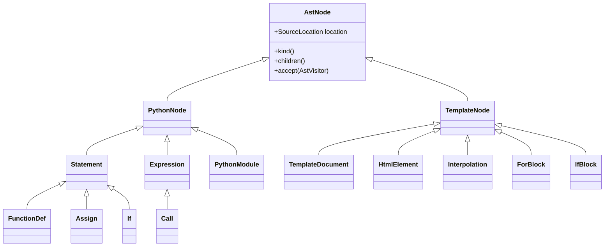

# AST architecture

ANTLR parse trees are converted into two independent object-oriented ASTs. Every concrete node inherits from `AstNode`, carries a `SourceLocation`, exposes its children polymorphically, and accepts an `AstVisitor`.

The Python AST supplies route handlers and the explicit arguments of each `render_template` call. Semantic analysis uses those call sites to establish template scopes. The generator then emits Python functions for both ASTs and joins them through a generated render-function registry; no source file is copied through as unparsed Python.

