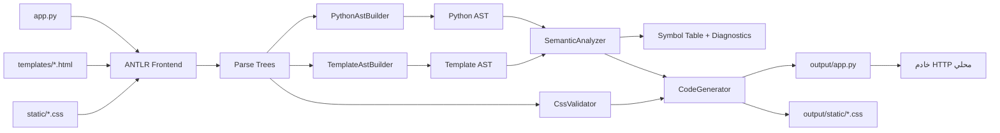

# التقرير النهائي لمشروع المترجم

## 1. ملخص المشروع

يقدّم هذا المشروع مترجمًا من مصدر إلى مصدر (Source-to-Source Compiler) مكتوبًا بلغة Java 17 وباستخدام ANTLR 4. يستقبل المترجم تطبيق ويب مكتوبًا بمجموعة فرعية مضبوطة من Python، وقوالب تجمع HTML مع صياغة شبيهة بـJinja2، وملفات CSS. بعد التحليل المعجمي والنحوي والدلالي، يولّد تطبيق Python قابلًا للتشغيل بخادم HTTP من المكتبة القياسية فقط، من دون Flask أو Jinja2.

التصميم عام وغير مرتبط بأسماء مثل `products` أو `delete_product`. لذلك يعمل تطبيقا `examples/products` و`examples/tasks` عبر القواعد والمراحل نفسها، ويبرهنان أن المترجم لا يولّد حلًا ثابتًا لمجال واحد.

## 2. التقنيات والمتطلبات

- **Java 17:** لغة تنفيذ المترجم وبناء نماذج AST والتحليل والتوليد.
- **ANTLR 4.13.2:** توليد المحللات المعجمية والنحوية من ملفات `.g4`.
- **Maven 3.9+:** إدارة البناء والاعتماديات وتشغيل الاختبارات وإنتاج `target/compiler.jar`.
- **JUnit 5.11.4:** اختبارات الوحدات والتكامل والقبول.
- **Python 3.10+:** تشغيل التطبيقات الناتجة واختبارات القبول، من دون حزم ويب خارجية.

## 3. البنية العامة ومسار الترجمة



تنفّذ `CompilerService` هذا التسلسل. تقرأ الملفات بترميز UTF-8، وتجمع التشخيصات، ولا تبدأ التوليد عند وجود خطأ. أما `ProjectResult` فيحمل Python AST، وخريطة القوالب، وجدول الرموز، والتشخيصات في نتيجة واحدة.

## 4. تنظيم ملفات المشروع

| المسار | المسؤولية |
|---|---|
| `src/main/antlr4/edu/compiler/antlr` | قواعد Python والقوالب وCSS؛ يولّد Maven أصناف ANTLR داخل `target/`. |
| `src/main/java/edu/compiler/frontend` | تشغيل Lexer وParser وتحويل أخطاء ANTLR إلى تشخيصات منظمة. |
| `src/main/java/edu/compiler/builder` | تحويل Parse Trees إلى عقد AST مستقلة. |
| `src/main/java/edu/compiler/ast` | العقد الأساسية، الموقع المصدري، الزائر، وطباعة الأشجار. |
| `src/main/java/edu/compiler/symbols` | تمثيل الرموز وجدولها وعرض النطاق والنوع المستنتج. |
| `src/main/java/edu/compiler/semantic` | فحص الأسماء والاستدعاءات والمسارات والقوالب وHTML وCSS. |
| `src/main/java/edu/compiler/generator` | توليد Python والقوالب وبيئة تشغيل الويب. |
| `src/main/java/edu/compiler/report` | إنشاء تقارير HTML تفاعلية للـAST وجدول الرموز. |
| `src/test/java/edu/compiler` | اختبارات الواجهة والبناء والدلالة والتوليد والتكامل. |
| `examples` | تطبيقات صحيحة وحالات سلبية تعرض رسائل الأخطاء. |
| `language-spec.md` | المواصفة الدقيقة للغة المدعومة. |
| `compiler_tool.py` | واجهة طرفية تفاعلية وقابلة للبرمجة للبناء والتشغيل والتقارير. |

المجلدات `target/` و`output/` و`reports/` ناتجة عن التشغيل ولا تُعد جزءًا من المصدر.

## 5. التحليل المعجمي والنحوي

توجد ثلاثة أزواج من القواعد:

1. `PythonSubsetLexer.g4` و`PythonSubsetParser.g4` لتحليل الدوال، والتعيين، والتحكم بالتدفق، والتعابير، والقوائم والقواميس، واستدعاءات الدوال، و`@app.route`.
2. `TemplateLexer.g4` و`TemplateParser.g4` للتمييز بين HTML والنص و`{{ ... }}` وكتل `` و``.
3. `CssLexer.g4` و`CssParser.g4` للمحددات وقواعد الخصائص والقيم المدعومة.

يعالج `PythonLexerBase` المسافات البادئة ويصدر الرمزين `INDENT` و`DEDENT`. تشغّل `Frontend` المحللات وتستبدل مستمعات ANTLR الافتراضية بـ`CollectingErrorListener`، فتظهر الأخطاء بصيغة موحّدة مثل:

```text
file:line:column: severity code: message
```

يُستخدم `LEX001` للأخطاء المعجمية و`SYN001` للأخطاء النحوية.

## 6. شجرة البنية المجرّدة AST

لا تُستخدم Parse Tree الناتجة من ANTLR بوصفها التمثيل النهائي. يحوّلها `PythonAstBuilder` و`TemplateAstBuilder` إلى شجرتين مستقلتين موجّهتين لمعنى البرنامج. ترث كل عقدة من `AstNode`، وتحمل `SourceLocation`، وتكشف أبناءها عبر `children()`، وتدعم تعدد الأشكال بواسطة `AstVisitor`.

```mermaid
classDiagram
direction TB
class AstNode {
  +SourceLocation location
  +kind()
  +detail()
  +children()
  +accept(AstVisitor)
}
class PythonNode
class Statement
class Expression
class Module
class Block
class FunctionDef
class Route
class Assign
class ExprStatement
class Return
class If
class Branch
class For
class While
class Flow
class Name
class Literal
class ListLiteral
class DictLiteral
class Unary
class Binary
class Attribute
class Subscript
class Call
class DictEntry
class Argument
class TemplateNode
class TemplateExpression
class Document
class Element
class HtmlAttribute
class Text
class Interpolation
class ForBlock
class IfBlock
class TemplateBranch
class TemplateName
class TemplateLiteral
class TemplateUnary
class TemplateBinary
class TemplateAttribute
class TemplateSubscript
class CssStylesheetRef

AstNode <|-- PythonNode
PythonNode <|-- Statement
PythonNode <|-- Expression
PythonNode <|-- Module
PythonNode <|-- Block
PythonNode <|-- Route
Statement <|-- FunctionDef
Statement <|-- Assign
Statement <|-- ExprStatement
Statement <|-- Return
Statement <|-- If
Statement <|-- For
Statement <|-- While
Statement <|-- Flow
PythonNode <|-- Branch
Expression <|-- Name
Expression <|-- Literal
Expression <|-- ListLiteral
Expression <|-- DictLiteral
Expression <|-- Unary
Expression <|-- Binary
Expression <|-- Attribute
Expression <|-- Subscript
Expression <|-- Call
PythonNode <|-- DictEntry
PythonNode <|-- Argument

AstNode <|-- TemplateNode
TemplateNode <|-- TemplateExpression
TemplateNode <|-- Document
TemplateNode <|-- Element
TemplateNode <|-- HtmlAttribute
TemplateNode <|-- Text
TemplateNode <|-- Interpolation
TemplateNode <|-- ForBlock
TemplateNode <|-- IfBlock
TemplateNode <|-- TemplateBranch
TemplateNode <|-- CssStylesheetRef
TemplateExpression <|-- TemplateName
TemplateExpression <|-- TemplateLiteral
TemplateExpression <|-- TemplateUnary
TemplateExpression <|-- TemplateBinary
TemplateExpression <|-- TemplateAttribute
TemplateExpression <|-- TemplateSubscript
```



تربط `DictEntry` مفتاح القاموس بقيمته، وتحفظ `Argument` وسيط الاستدعاء وقيمته. تمثّل `FunctionDef` اسم الدالة ومعاملاتها و`Route` الاختياري وجسمها، بينما تحفظ `If` فروع `if/elif` وجسم `else`. وتمثل Template AST بنية HTML والنصوص والاستيفاء والحلقات والشروط. يبقى CSS أصلًا مُحللًا ومتحققًا منه ثم يُنسخ كما هو؛ ويوفر النموذج `CssStylesheetRef` كعقدة مرجعية من دون إنشاء AST رئيسية ثالثة.

يربط التحليل الدلالي الشجرتين: فوسائط `render_template("page.html", items=items)` الاسمية تنشئ نطاق القالب، ثم يستخدم المولّد القيم الفعلية وقت الطلب لتشغيل دالة العرض الناتجة.

## 7. جدول الرموز والتحليل الدلالي

يجمع `SemanticAnalyzer` تعريفات الدوال ومتغيرات الوحدة أولًا، مما يسمح بالاستدعاءات الأمامية والاستدعاء الذاتي. ثم يبني نطاقات للدوال ومعاملاتها ومتغيرات الحلقات وربط القوالب. يسجل `SymbolTable` اسم كل رمز ونوعه ونطاقه وموقعه ونوعه المستنتج. أنواع الرموز هي: `VARIABLE` و`FUNCTION` و`PARAMETER` و`LOOP_VARIABLE` و`TEMPLATE_BINDING`.

تشمل الفحوص الأساسية:

- حل الأسماء ومنع الاسم غير المعرّف (`SEM001`).
- التحقق من عدد وسائط الدوال والدوال المضمنة (`SEM002`).
- منع تكرار المسار لنفس HTTP method (`SEM003`).
- التحقق من وجود القالب واسمه الثابت (`SEM004`).
- مطابقة أسماء القالب مع سياق العرض (`SEM005`) وقابلية هدف الحلقة للتكرار (`SEM006`).
- رفض الدوال والطرائق غير المدعومة (`SEM007`) وسياق `return/break/continue` غير القانوني (`SEM008`).
- كشف التكرار في التصريحات أو المعاملات (`SEM009`) وعدم تطابق معاملات المسار مع الدالة (`SEM011`).
- رفض تراكيب المعاملات المعروفة الخطأ (`SEM012`)، وعناصر وسمات HTML غير المدعومة (`SEM013`)، وخصائص CSS غير المدعومة (`SEM014`).

يدعم المحلل دوالًا مضمنة محددة مثل `len` و`range` و`str` و`int`، وطرائق مثل `append` و`remove` و`get`. هذه السياسة المقيدة تمنع قبول استدعاءات لا يستطيع المترجم التحقق منها.

## 8. توليد الشيفرة وبيئة التشغيل

ينسّق `CodeGenerator` ثلاثة مولدات:

- `PythonEmitter`: يحوّل عقد Python AST إلى تعيينات ودوال وتعابير وتعليمات تحكم Python صالحة.
- `TemplateEmitter`: يولّد دوال عرض للقوالب؛ يحوّل الحلقات والشروط إلى Python ويطبّق escaping على الاستيفاء النصي وسمات HTML.
- `WebRuntimeEmitter`: يضيف سجل المسارات وخادم `ThreadingHTTPServer` وتحليل الطلبات والاستجابات وخدمة CSS.

ينتج الأمر `compile` ملف `output/app.py` وينسخ ملفات CSS المتحقق منها إلى `output/static`. تُقيّم قيم سياق القالب عند كل طلب، لذلك تظهر تعديلات القوائم في الطلبات اللاحقة ولا ينتج المترجم صفحات ثابتة مسبقًا.

تدعم بيئة التشغيل `GET` و`POST`، والمعاملات الصحيحة مثل `<int:item_id>`، والنماذج ذات `application/x-www-form-urlencoded`، وإعادة التوجيه بحالة 303. تعيد المسارات المفقودة 404، والطريقة غير المدعومة 405، والمدخل السيئ 400، والخطأ الداخلي 500.

## 9. السلامة والحدود التشغيلية

- تهرّب قيم القوالب بواسطة `html.escape(..., quote=True)`، وتعرض `None` كنص فارغ.
- لا تستخدم الشيفرة الناتجة `eval` أو `exec`.
- يقتصر جسم POST على 1 MiB.
- تُقبل إعادة التوجيه إلى مسار محلي يبدأ بـ`/` ولا يبدأ بـ`//`.
- تُخدم ملفات `.css` فقط بعد التحقق من بقاء المسار داخل مجلد `static`.
- لا تُعرض تفاصيل الاستثناء أو stack trace للمستخدم عند الخطأ 500.

الخادم تعليمي ومحلي؛ البيانات محفوظة في الذاكرة وتضيع بعد إعادة التشغيل. المصادقة وقاعدة البيانات وTLS وتحديد المعدل والعزل متعدد المستخدمين ليست ضمن نطاق الإصدار الحالي.

## 10. واجهة الأوامر والتقارير

يبني `Main` واجهة JAR بثلاثة أوامر:

```powershell
mvn clean package
java -jar target/compiler.jar compile examples/products/app.py --templates examples/products/templates --css examples/products/static --out output/products
java -jar target/compiler.jar ast examples/products/app.py --templates examples/products/templates --css examples/products/static
java -jar target/compiler.jar symbols examples/products/app.py --templates examples/products/templates --css examples/products/static
python output/products/app.py 8000
```

يطبع `ast` جميع العقد وأبناءها ومواقعها، ويطبع `symbols` جدول الرموز. يضيف الخيار `--html FILE` تقريرًا مستقلًا يعمل دون اتصال. يعرض تقرير AST رسمًا تفاعليًا يدعم التكبير وطي الفروع والبحث النصي، بينما يعرض تقرير الرموز الاسم والنوع والنطاق والموقع.

يوفر `compiler_tool.py` قائمة تفاعلية وأوامرًا مختصرة مثل:

```powershell
python compiler_tool.py list
python compiler_tool.py run products --port 8000
python compiler_tool.py reports products --open
python compiler_tool.py test
```

ويعيد بناء JAR تلقائيًا إذا كان مفقودًا أو أقدم من ملفات المصدر.

## 11. الأمثلة والاختبارات

يمثل `examples/products` التطبيق المرجعي: عرض المنتجات وصورها عبر روابط URL، وإضافة منتج، وعرض التفاصيل، والحذف، وخدمة التنسيق. ويمثل `examples/tasks` مجالًا مختلفًا لاختبار عمومية التصميم. تحتوي `examples/negative-tests` حالات مقصودة مثل الاسم غير المعرّف، وعدد الوسائط الخاطئ، والمسار المكرر، والقالب المفقود، وربط القالب غير الصحيح.

تغطي حزمة JUnit:

- `FrontendTest` للقواعد الثلاث.
- `AstBuilderTest` لبناء الشجرتين والطباعة.
- `SemanticAnalyzerTest` للرموز والتشخيصات الدلالية.
- `CodeGeneratorTest` لصحة Python الناتج والهروب الآمن.
- `HtmlReportWriterTest` لتقارير HTML.
- `PythonAcceptanceTest` للحسابات، والاستدعاءات الأمامية، والعودية، والحلقات، والتحكم بالتدفق، والطفرات.
- `ProductApplicationTest` و`SecondApplicationTest` لتشغيل تطبيقين كاملين، و`TerminalToolTest` للأداة الطرفية.

يمكن تنفيذ التحقق الكامل عبر:

```powershell
mvn test
```

## 12. نطاق اللغة والقيود

يدعم Python المقيد القيم الأساسية والقوائم والقواميس، والتعيين العادي والمركب، والتعابير الحسابية والمنطقية والمقارنات، والفهرسة والوصول للسمات، والدوال، و`if/elif/else` و`for` و`while` و`break/continue/pass`. وتدعم القوالب الاستيفاء و`for` و`if/elif/else` والتداخل. كما يدعم المشروع مجموعة مضبوطة من عناصر HTML وسماته ومحددات وخصائص CSS.

لا يدعم الإصدار الحالي الاستيراد العام، والأصناف، والاستثناءات، و`async`، والمولدات، وميزات Python الكاملة، ولا وراثة القوالب ومرشحات Jinja2 وJavaScript وHTML/CSS الكاملين. رفض هذه الميزات صراحةً جزء من تصميم اللغة، وليس خللًا في التنفيذ.

## 13. الخلاصة

يحقق المشروع دورة ترجمة متكاملة: قراءة ثلاث لغات مترابطة، بناء شجرتي AST كائنيتين، إنشاء جدول رموز، إجراء فحوص دلالية مشتركة بين Python والقوالب، ثم توليد تطبيق ويب يعمل فعليًا من دون إطار خارجي. ويجعل فصل المراحل، والتشخيصات ذات المواقع، وتطبيق المجال الثاني، واختبارات HTTP من السهل التحقق من أن الناتج مبني من بنية البرنامج ومعناه، لا من نسخ المصدر أو تخصيص المترجم لمثال المنتجات.

قبل التسليم النهائي يجب استكمال رابط المستودع وأسماء أعضاء الفريق في `submission-info.txt`، ثم إنشاء الحزمة المطلوبة مع استبعاد المجلدات الناتجة.
